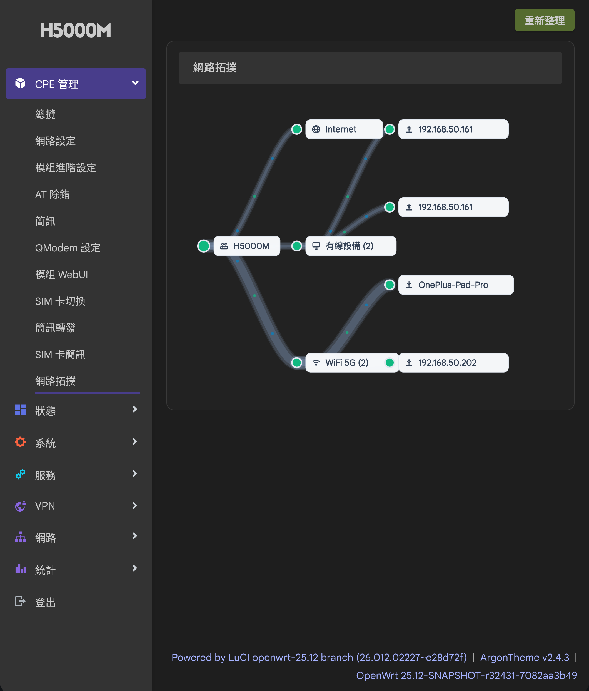

> ## 本分支修改說明（TomAThub fork）
>
> 本分支為 [FUjr/QModem](https://github.com/FUjr/QModem) 的 fork，針對 Hiveton H5000M（OpenWrt 25.12，mediatek/filogic）自編韌體加入以下修改。
>
> ### luci-app-qmodem-next（CPE 管理）
> - **儀表板重寫**：即時上傳/下載速率（netifd 為主、qmodem 統計為備援）、SVG 速率曲線圖、訊號強度與頻點/頻段顯示（內建 LTE EARFCN→頻段對照表；修正 quectel `AT+QGDNRCNT` 上傳/下載方向互換問題）
> - **營運商名稱顯示**：內建 MCC-MNC 對照表，總覽頁與 ISP 徽章顯示電信商名稱
> - **AT 快速指令與 APN 設定檔**：自訂 AT 指令及 APN 設定檔以 uci 儲存、列表顯示目前 APN、漫遊開關（`QNWPREFCFG`）
> - **簡訊修正**：DB 模式下「卡簡訊」刪除不再出現 `Invalid message index`（index 自動以資料庫 id 補上）；SMS 頁面路徑配合移至 `admin/cpe`
> - **其他**：安裝後自動重啟 rpcd 使 ACL 立即生效、選單與權限（ACL）調整
> - **網路拓撲圖**：CPE 管理新增「網路拓撲」分頁（`admin/cpe/topology`），以純 SVG 重現 Hiveton HigoOS 原生網路拓撲視圖（無外部 JS 圖庫）
>   - 分層佈局：Internet → 路由器 → 有線設備／WiFi 2.4G／WiFi 5G → 各裝置，含上下行流量粒子動畫
>   - 連線粗細反映各連結實際速率：WiFi 客戶端取交談速率（assoclist tx/rx rate）、Internet 連線取 WAN 即時流量
>   - 裝置偵測：DHCP 租約與 ARP 表合併（靜態 IP、未走 DHCP 的裝置同樣顯示），WiFi 客戶端取自各 radio assoclist
>   - 有線裝置在線偵測：平行 ping 探測＋核心鄰居確認狀態（`ip neigh`）混合判斷，ARP 殘留紀錄中的離線裝置自動隱藏（探測元件缺失時自動退回顯示全部）；WiFi 端以即時 assoclist 為準
>   - 裝置名稱解析鏈：DHCP hostname → 靜態租約名稱（`dhcp` host 段）→ LuCI 主機提示 → IP/MAC
>   - Internet 在線狀態以 qmodem 撥號狀態為準（netifd 介面狀態備援）
>   - 自適應版面：圖高隨裝置數、圖寬隨容器寬度調整，直式／橫式皆不變形、不裁切；懸停節點顯示名稱／類型／IP／MAC／狀態；每 10 秒自動更新
> - **繁體中文介面**：新增 `po/zh_Hant` 翻譯（建置 `luci-i18n-qmodem-next-zh-tw` 套件）
>
> ### 預先編譯的安裝檔（`ipks/` 與 `ipks-24.10/`）
> 兩組目錄內容結構相同：**主要套件**（`luci-app-qmodem-next`，含上述所有修改）＋ `luci-i18n-qmodem-next-zh-tw`／`zh-cn` 翻譯、**qmodem 核心與附屬**（`qmodem`、`libqmodem-sms`、`qmodem-smsd`、`modem_scan`、`ubus-at-daemon`、`qmodem-settings`、`qmodem-seal`、`sms-forwarder-next`、`sms-tool_q`、`tom_modem`、`quectel-CM-5G-M`、`ndisc6`）、**系統相依**（`bc`、`curl`／`libcurl4`、`jq`、`libsqlite3-0`、`ucode` 系列、`coreutils` 系列、`flock`、`xxd`、`usbutils`／`usbids`／`pciids`、`ca-bundle`、`libmbedtls21`、`libsodium`、`libnghttp2-14`、`libncurses6`／`terminfo`、`zlib`）。上傳路由器後以 `opkg install *.ipk` 一次安裝（相依順序由 opkg 處理，完整說明見各目錄內 `INSTALL.txt`）。
> - **`ipks/`**：OpenWrt **25.12**（`aarch64_cortex-a53`）建置，供 Hiveton H5000M 自編韌體使用
> - **`ipks-24.10/`**：以官方 **24.10.0 SDK** 編譯（相同的 `luci-app-qmodem-next r53` 原始碼），連結 24.10 官方套件庫的 `libubus20250102`／`libubox20240329` ABI，適用於同架構（`aarch64_cortex-a53`）的 24.10.x 官方韌體
> - **版本政策**：僅保留最新且運作正常的版本；舊版與出問題的版本直接從目錄移除（版本編號見檔名中的 `PKG_RELEASE`）
> - **相容性說明**：預編 ipk 綁定韌體的 `libubus`／`libubox` soname，**25.12 與 24.10 兩組不相通用**；其他 OpenWrt 版本請以對應版本的 SDK 自行編譯本 feed
> - 風扇溫控（`luci-app-fan-ctrl`）與獨立版網路拓撲（`luci-app-net-topology`）不屬於本 repo 範圍，未收錄於上述目錄
>
> ### 介面截圖
> **CPE 管理 — 總攬**（即時速率曲線、已連線裝置、WiFi 客戶端、數據機與 SIM 資訊）
>
> 
>
> **CPE 管理 — 網路拓撲**（Internet → 路由器 → 有線／WiFi 裝置分層，連線粗細反映各連結速率）
>
> 
>
> ---

# QModem

English | [简体中文](README.zh-cn.md)

[](https://github.com/FUjr/modem_feeds/actions/workflows/main.yml)

QModem is a cellular modem management and dialing stack for OpenWrt and ImmortalWrt. It discovers USB and PCIe modems, manages AT and data interfaces, and provides dialing, status, SMS, and vendor-specific controls through LuCI.

It is intended for custom 4G/5G routers, embedded gateways, and multi-modem devices. It is not a desktop ModemManager replacement and cannot compensate for kernel drivers missing from the target firmware.

## Capabilities

| Area | Scope |
| --- | --- |
| Discovery | USB and PCIe modems with physical-slot binding |
| Data sessions | QMI, MBIM, NCM, ECM, RNDIS, and others depending on modem and driver |
| Status | SIM, registration, signal, cell, and firmware information |
| Advanced controls | RAT preference, band/cell locking, SIM switching, depending on vendor and model |
| SMS | Send, receive, PDU, and optional forwarding; long-SMS behavior varies by modem |
| OpenWrt integration | UCI, ubus, rpcd, procd, and LuCI |

An entry in the [support list](docs/support_list.md) means that a matching project profile exists. It does not mean every firmware, interface composition, or advanced operation has been verified on hardware by the maintainers.

## Architecture

```text
LuCI
  |
rpcd / ubus
  |
QModem control and dialer ---- modem_scand discovery daemon
  |
generic + vendor adapters
  |
shared AT command wrappers
  |
ubus-at-daemon / tom_modem
  |
USB / PCIe cellular modem
```

The core package is `qmodem`. The pure-JavaScript `luci-app-qmodem-next` is the recommended UI. The legacy `luci-app-qmodem` and separate SMS, MWAN, and TTL packages remain available, but the two main UIs should not be installed together.

## Quick start

Add the feed to `feeds.conf.default` in an OpenWrt source tree:

```text
src-git qmodem https://github.com/FUjr/QModem.git;main
```

Then run:

```sh
./scripts/feeds update qmodem
./scripts/feeds install -a -p qmodem
make menuconfig
```

Select `luci-app-qmodem-next` under `LuCI -> Applications`. The target firmware must also contain USB, serial, QMI, MBIM, or MHI drivers matching the modem, protocol, kernel, and hardware topology.

The detailed English manuals are currently maintained in the existing [user guide](docs/user-guide.md) and [developer guide](docs/developer-guide.md). The new structured documentation is being introduced in Chinese first:

- [User documentation](docs/user/index.zh-cn.md)
- [Developer documentation](docs/developer/index.zh-cn.md)
- [Branch and release policy](docs/release/branch-policy.zh-cn.md)
- [Version migration and issue reporting](docs/release/version-migration.zh-cn.md)
- [Supported hardware](docs/support_list.md)
- [rpcd API](docs/qmodem-rpcd-interface.md)
- [AT fixture development](testcases/README.md)

## Important boundaries

- Do not let multiple management applications read and write the same AT port concurrently.
- Band locking, cell locking, IMEI changes, and modem resets can disrupt service; confirm model support and recovery steps first.
- Kernel packages from a release must match the target firmware ABI. Do not treat `--force-depends` as a compatibility solution.
- A successful package build does not prove that AT operations or data sessions work on a specific modem.

## Reporting issues

Include the router model, firmware and QModem versions, exact modem model, USB/PCIe topology, dialing protocol, and reproducible steps. Redact IMEI, IMSI, ICCID, phone numbers, APNs, credentials, and SMS content before publishing logs or fixtures.

## Contributing

AT commands used by vendor and dialing implementations must be defined through `cmd_*` wrappers under `application/qmodem/files/usr/share/qmodem/cmds/`. CI enforces this boundary. Real-device, redacted fixtures are preferred over screenshots or model-name-only support claims.

## License

The repository [LICENSE](LICENSE) contains the Mozilla Public License 2.0 text plus an additional restriction prohibiting commercial use. It is therefore not an unmodified standard MPL 2.0 grant. Read the complete license before using, distributing, or integrating the project.

## Acknowledgments

QModem uses or builds on work from the 5G-Modem-Support, luci-app-4gmodem, sms_tool, gl-modem-at, sendat, and qosmio/nss-packages communities. Consult the files and Git history in each component for exact provenance and licensing.
